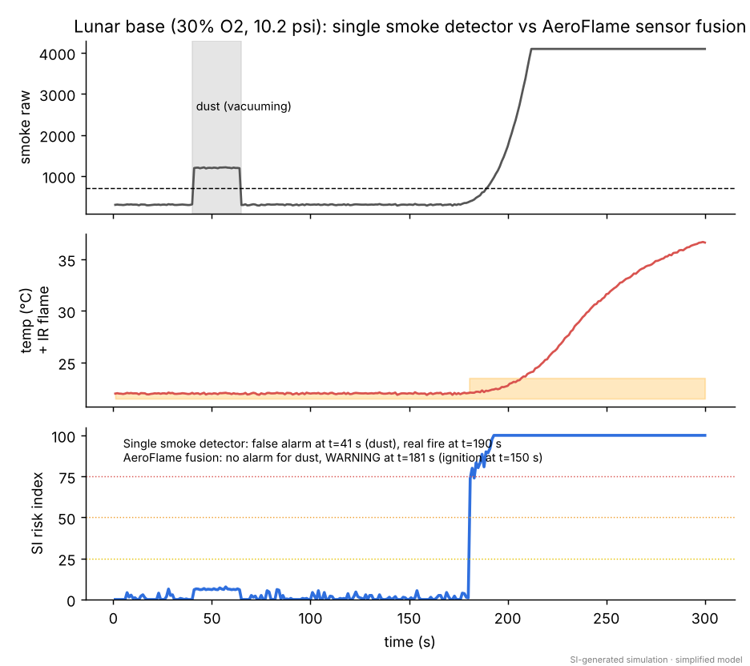

# 🔥 AeroFlame SI — Flame in Freefall

**NASA Space Apps Challenge 2026 · Casablanca** · Challenge: *Flame in Freefall: SI-Powered Fire Safety Insights from Microgravity Combustion Data*

AeroFlame SI combines a low-cost **edge sensor node** (IR flame + smoke + temperature/pressure) with a
**Super Intelligence (SI) dashboard** that fuses the readings into a fire-risk index and explains each alert
with findings from NASA's **Physical Science Informatics (PSI)** combustion experiments, for spacecraft,
space stations, lunar and Martian bases and rovers.

**Live demo:** https://aeroflame-si.vercel.app · **Demo video (30 s):** [add YouTube link]



## What it does
- **Live Habitat Monitor**: streams telemetry from the ESP32 node (or a built-in simulation), computes an SI risk
  index (NOMINAL / WATCH / WARNING / FIRE) scaled by the habitat's oxygen level, rejects dust-only nuisance alarms,
  and suggests crew actions.
- **NASA findings for each alert**: links the alert's pillar (Prevention / Detection / Suppression) to ranked PSI
  findings, and the SI explains the situation at Student, Engineer or Researcher level, naming its sources.
- **NASA PSI Insights**: pick an environment and get PSI findings ranked by relevance with CSV export.

## Web app (React)
The public site lives in [`web/`](web): a React (Vite) app with the same model and risk index as the Python code,
ported to JavaScript and checked against it (`npm test`).
- **Live monitor** with a side view of the module (smoke drifts with the cabin airflow), Ignite / Dust / Reset,
  time ×1 / ×4 / ×10, an event log that compares AeroFlame with a single smoke detector, and CSV export.
- **Guided tour** (7 steps) that runs the dust false alarm and the real fire for a first-time visitor.
- **ESP32 node over USB in the browser** (Web Serial, Chrome or Edge on a computer): the same page reads the real sensors.
- **NASA findings** with a source link and the basis of each one (flight experiment, ground test, model, challenge report).
- **Earth reference case** (21% O2, 14.7 psi, 1 g, buoyant plume to a ceiling detector) next to the six space environments.
- **30-second demo video and a 3D view** of the node in a module, on the "Video and how it works" tab.
- **SI endpoint** `web/api/explain.js` (serverless): the Gemini key stays on the server as `GEMINI_API_KEY`;
  the prompt is built on the server from the live readings and the findings in `web/src/data/findings.json`.

```
cd web
npm install
npm run dev      # http://localhost:5173 (the SI endpoint runs on Vercel, or with `vercel dev`)
npm test         # JavaScript model against the Python reference values
```

## Why it matters (NASA grounding)
- Without buoyancy, smoke does not rise to a ceiling; NASA places ISS smoke detectors in the cabin air return vents.
- NASA's smoke experiments (SAME) found the ISS detector failed to alarm for Kapton smoke in half of the tests and
  for Teflon smoke in two-thirds, and dust causes nuisance alarms. A single fire signal is not enough, so AeroFlame
  fuses three.
- Planned lunar bases and pressurized rovers may use ≥30% O₂ at ≤10.2 psi, which makes materials burn more easily.

## Simulation results (simplified model, assumptions in `simulation/aeroflame_model.py`)
| Result | Value |
|---|---|
| Smoke alarm after ignition: Earth reference / microgravity 0.10 m/s / stagnant 0.03 m/s | 41 s / 57 s / 103 s |
| Thin-fabric flame spread at 21% / 30% / 100% O₂ | 1.0 / 2.5 / 14.2 mm/s |
| Lunar base: dust event | single detector false-alarms; AeroFlame stays NOMINAL |
| Lunar base: real ignition | AeroFlame WARNING 31 s after ignition |

## NASA data & resources
- NASA Physical Science Informatics (PSI): BASS/BASS-II, Saffire I–III, SAME/SAME-R, DAFT/DAFT-2, FLEX/FLEX-2, CFI, ACME, SPICE, SLICE
- NASA fire-detection white paper (NTRS 20210022143) and SAME results
- Flame in Freefall challenge report (NASA Space Apps 2026)

## Tech stack
Python · Streamlit · pandas · scikit-learn (TF-IDF) / sentence-transformers (all-MiniLM-L6-v2, optional Intel OpenVINO) ·
Google Gemini API (SI explanations) · ESP32 (Arduino) with IR flame sensor, MQ-2, BME280, buzzer · matplotlib.

## Run it
**Windows:** download the repo, double-click `setup.bat`, then `run.bat` → http://localhost:8501
**Any OS:**
```bash
python -m venv venv && source venv/bin/activate      # Windows: venv\Scripts\activate
pip install -r requirements-full.txt                 # or requirements.txt for the light version
streamlit run app.py
```
Optional: put `GEMINI_API_KEY=...` in a `.env` file (free key: https://aistudio.google.com/apikey).

## Repository map
| Path | What |
|---|---|
| `app.py`, `monitor.py`, `insights.py`, `core.py` | Streamlit app (router, live monitor, PSI insights, shared code) |
| `findings.csv` | Curated PSI findings (experiment, pillar, environments, finding, source) |
| `si_core_prompt.md` | Instructions that ground the SI in the challenge report |
| `hardware/` | ESP32 firmware + wiring |
| `simulation/` | Habitat fire model, figures and telemetry CSV |

## Use of Super Intelligence (SI)
SI tools (Claude, Gemini) were used to speed up coding, generate the explainer video and figures (watermarked
"SI-generated"), and check drafts against the judging criteria. Inside the product, Gemini writes explanations
only from retrieved NASA findings. The solution concept is the team's own.

## Team
Mohamed El Hamdy · Haitham Dhaimi · Nawal El Kellali · Hoda El Khayder · Hala Barbou
